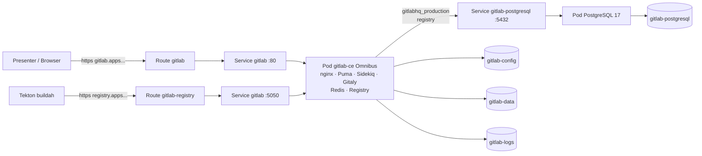

# ACT 5 — GitLab in the Cluster (pre-demo setup)

> **Script:** `scripts/30-gitlab-setup.sh` (run **before** the session — first boot takes ~5–10 min)
> **Manifests:** `cicd/gitlab/gitlab-postgresql.yaml` (database, applied first) · `cicd/gitlab/gitlab-omnibus.yaml` (GitLab)
> **Overview:** ACT 5 needs a Git server that can send webhooks to the cluster and a container registry for the images the pipeline builds. A self-managed **GitLab** running *inside* OpenShift provides both — no external accounts, no internet-facing webhook endpoint required.

---

## Why GitLab Inside the Cluster

The demo cluster lives on a private network. A public Git service (GitHub, gitlab.com) cannot deliver webhooks to it, so **Pipelines-as-Code** (step 35) would never be triggered.
Running GitLab in the same cluster solves that, and also gives us an in-house **Container Registry** for the pipeline to push to.

> **Key point:** This mirrors a common enterprise setup — source control, CI and registry all run on-premises, next to the workloads.

---

## Architecture



| Component | Choice | Notes |
|---|---|---|
| Database | **PostgreSQL 17** (`registry.access.redhat.com/hi/postgresql`, `GITLAB_POSTGRES_IMAGE`) — own Deployment, PVC 5Gi, Service `gitlab-postgresql` | Deployed and checked **before** GitLab. Two databases: `gitlabhq_production` (Rails) and `registry` (Container Registry metadata, created by an init ConfigMap). Runs under the `restricted` SCC |
| GitLab | `gitlab/gitlab-ce` **Omnibus** (`GITLAB_IMAGE`) | One container with Redis, nginx, Gitaly and Container Registry; **bundled PostgreSQL disabled** (`postgresql['enable'] = false`) |
| Namespace | `gitlab` | Separate from all demo namespaces |
| Security | ServiceAccount `gitlab` + `anyuid` SCC | Omnibus starts as root and drops to service users internally |
| TLS | Edge Routes (Router certificate) | nginx inside the pod listens on plain HTTP (80 web/API/Git, 5050 registry) |
| Storage | PostgreSQL 5Gi · GitLab config 1Gi · logs 2Gi · data 20Gi | `STORAGE_CLASS` or cluster default (auto-detected) |
| Footprint | requests 500m / 3Gi, limit 6Gi | Puma single mode, 10 Sidekiq threads, built-in Prometheus off |

> **Note:** Same database layout as the cosign/ACS lab (PostgreSQL 17 + separate `registry` DB), but GitLab itself runs as a single Omnibus container instead of the GitLab Operator + external Redis/MinIO. GitLab 19 requires PostgreSQL 17.

---

## What the Script Does

| # | Action | Idempotency |
|---|---|---|
| 1 | Creates namespace `gitlab`, grants `anyuid` to SA `gitlab` | create-or-reuse |
| 2 | Creates Secret `gitlab-demo-credentials` with random **root**, **database** and **registry-database** passwords | each generated once, then reused |
| 3 | Deploys **PostgreSQL 17** (`gitlab-postgresql.yaml`), waits for it and checks with `psql` that `gitlabhq_production` and `registry` exist | `oc apply` |
| 4 | Deploys **GitLab** (`gitlab-omnibus.yaml`) pointing at that database; waits for the rollout and the Route | `oc apply` |
| 5 | Mints a **root API token** via `gitlab-rails runner` | reused while valid |
| 6 | Instance settings: allow webhooks to local addresses, disable Auto DevOps, disable sign-up | `PUT` (same values) |
| 7 | Creates public group `ked-demo` and project `ked-demo/ocp-demo-app` | lookup first |
| 8 | Pushes **only** `app/ocp-demo-app` as the app repo (`main`) | only while the repo is empty |
| 9 | Creates project access token **`tekton-ci`** (Maintainer · `api`, repo + registry read/write) | reused while valid |
| 10 | **OpenShift Pipelines prep:** TektonConfig `spec.pipeline.coschedule` → `pipelineruns` (original value kept in annotation `ked-demo/original-coschedule`); waits until the controller's `feature-flags` report it | only if different |
| 11 | **Registry trust for the nodes:** Router CA → ConfigMap `openshift-config/ked-demo-registry-ca` (key = registry host) → `image.config` `additionalTrustedCA`; waits for `openshift-apiserver` to roll out (≈1–2 min API blip on SNO) | only if different |
| 12 | Verifies: tables in both databases, bundled PostgreSQL not running, registry `/v2/` → HTTP 401 | — |

All credentials are generated at runtime and stored **only** in the cluster Secret `gitlab-demo-credentials` (`root-password`, `db-password`, `registry-db-password`, `root-token`, `ci-username`, `ci-token`). Nothing secret is written to the repo.

> **Why these instance settings?**
> - **Local webhooks** — GitLab blocks webhooks to private IPs by default; the Pipelines-as-Code controller is in-cluster.
> - **No Auto DevOps** — GitLab CI is not used. Without this, every push would create a stuck GitLab pipeline next to the Tekton status.
> - **No sign-up** — only `root` and the CI bot exist.

> **Why change the Tekton coschedule mode?**
> The build pipeline (step 32) gives the maven task **two PVC workspaces**: a per-run source volume and a persistent **Maven cache** (`maven-repo`). With the default affinity-assistant mode `workspaces`, Tekton rejects that TaskRun (`more than one PersistentVolumeClaim is bound`). Mode `pipelineruns` schedules all PVCs of a PipelineRun on the same node, so plain **RWO** storage is enough — no RWX needed. It is a cluster-wide setting, so it is done here (pre-demo) and reverted by `39-teardown.sh`.

---

## Run It

```bash
./scripts/30-gitlab-setup.sh
```

Expected end of output:

```
GitLab is ready for ACT 5.
  Web UI   : https://gitlab.apps.<cluster-domain>  (user: root)
  App repo : https://gitlab.apps.<cluster-domain>/ked-demo/ocp-demo-app
  Registry : registry.apps.<cluster-domain>/ked-demo/ocp-demo-app
```

Root password for the browser login:

```bash
oc get secret gitlab-demo-credentials -n gitlab \
  -o jsonpath='{.data.root-password}' | base64 -d; echo
```

Re-seed the app repo from `app/ocp-demo-app` (e.g. after the Dockerfile or `.tekton/` changes) — **overwrites `main`**:

```bash
GITLAB_RESEED=1 ./scripts/30-gitlab-setup.sh
```

---

## What to Show During the Demo

1. **GitLab UI** → log in as `root` → project **ked-demo / ocp-demo-app**: the app source only (`pom.xml`, `src/`), a separate repo from the demo material.
2. **Deploy → Container Registry**: empty for now — the pipeline (step 32) pushes the first image here.
3. **OpenShift console → Project `gitlab` → Topology**: GitLab and its PostgreSQL are just workloads on the platform (two Deployments, PVCs, Services, two Routes).

> **Key point:** The platform hosts its own toolchain. The same primitives used for the app in ACT 2–3 (Deployment, Service, Route, PVC) run the Git server and registry that feed the CI pipeline.

---

## Verify

```bash
oc get deploy,svc,route,pvc -n gitlab
oc exec -n gitlab deploy/gitlab-postgresql -- psql -U gitlab -d postgres -c '\l'   # gitlabhq_production, registry
curl -sk -o /dev/null -w '%{http_code}\n' https://registry.apps.<cluster-domain>/v2/   # 401
oc get cm feature-flags -n openshift-pipelines -o jsonpath='{.data.coschedule}{"\n"}'  # pipelineruns
```

---

## Troubleshooting

| Symptom | Cause / Fix |
|---|---|
| Pod `Pending`, PVCs `no storage class is set` | Cluster has no default StorageClass. The script auto-picks one; set `STORAGE_CLASS` in `demo-config.sh` to choose explicitly. Unbound PVCs with a wrong class are re-created automatically on re-run. |
| `ImagePullBackOff` / slow first start | The image is ~3.9 GB; the first pull takes a few minutes. |
| Startup probe `502` for a while | Normal on first boot (reconfigure + DB migrations, then services restart). |
| GitLab logs `PG::ConnectionBad` / password errors | Database passwords are applied only at the first PostgreSQL init. If the Secret was re-created while the `gitlab-postgresql` PVC was kept, run `scripts/39-teardown.sh` and set up again. |
| Browser / CLI TLS warnings | Router default certificate is self-signed — use `-k` / `--tls-verify=false` / `SSL_VERIFY=false`. |
| Rollout `exceeded its progress deadline` | First boot is longer than usual — re-run the script (it continues where it stopped). |
| App pod `ImagePullBackOff … x509: certificate signed by unknown authority` (step 32) | Nodes do not trust the Router CA for the registry — re-run the script (step 11). Propagation to the nodes takes ~1 min, no reboot. |
| TaskRun `more than one PersistentVolumeClaim is bound` | TektonConfig coschedule is back to `workspaces` (e.g. operator reset) — re-run the script. |

---

## Cleanup

```bash
./scripts/39-teardown.sh
```

Deletes the ACT 5 projects (`ocp-demo-cicd`, `ocp-demo-dev`) and the `gitlab` namespace (GitLab + PostgreSQL Deployments, PVCs with repos/registry/database, Routes, credentials Secret, anyuid RoleBinding) after a `yes` confirmation, and waits until it is fully gone so `30-gitlab-setup.sh` can be re-run right away. It also restores the TektonConfig coschedule mode and removes the registry CA from `image.config` (only what step 30 changed). Other cluster-wide settings (e.g. the default StorageClass) are not touched.

`scripts/99-teardown.sh` also asks separately whether to delete the `gitlab` namespace (it is pre-demo infrastructure and is usually kept between sessions).

---

## ➡️ Next: [OpenShift Pipelines Introduction](31-pipelines-intro.md)
