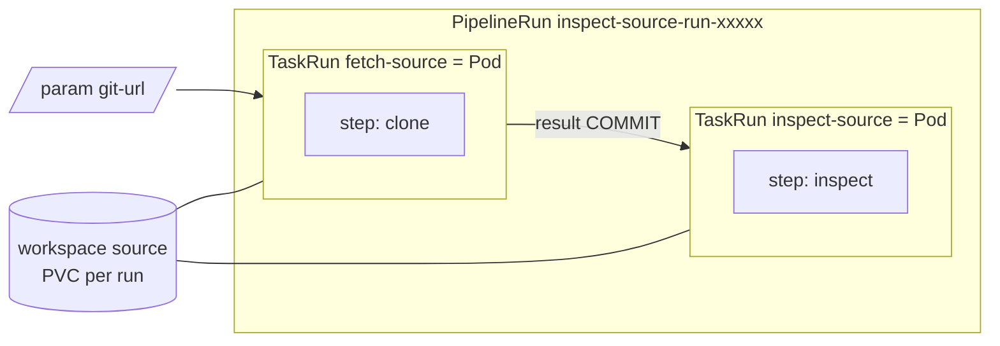

# ACT 5 — OpenShift Pipelines (Tekton): Introduction

> **Script:** `scripts/31-pipelines-intro.sh` (live, ~10 min)
> **Manifests:** `cicd/tekton/intro/hello-task.yaml` · `cicd/tekton/intro/inspect-source-pipeline.yaml` · `cicd/tekton/intro/workspace-template.yaml`
> **Prerequisite:** `scripts/30-gitlab-setup.sh` (GitLab + app repo `ked-demo/ocp-demo-app`)
> **Overview:** The building blocks of Tekton on the real cluster — from a single Step to a Pipeline that clones the app from the in-cluster GitLab. No build yet: that is step 32.

---

## Why Tekton

| Traditional CI server | OpenShift Pipelines (Tekton) |
|---|---|
| A central server (and its plugins) to install, patch and scale | Nothing to run: pipelines are **Kubernetes CRDs**, executed by a controller |
| Shared build agents, shared state between jobs | Every task runs in its **own Pod**, from a container image, then disappears |
| Pipeline definition lives in the CI tool | Pipeline definition is **YAML in Git** (and in the app repo with Pipelines-as-Code, step 35) |
| Separate permissions model | **Kubernetes RBAC**, namespaces, ServiceAccounts, SCCs |

> **Key point:** OpenShift CI/CD = two operators. **Pipelines (Tekton) = CI** — build, test, scan, push. **GitOps (Argo CD) = CD** — keep the cluster in sync with Git (later steps).

---

## The Building Blocks



| Concept | What it is | In this step |
|---|---|---|
| **Step** | A container: image + command/script | `say-hello`, `read-result` |
| **Task** | Ordered steps in **one Pod** | `hello` (ours), `git-clone` (shipped) |
| **Pipeline** | Tasks wired together (order, data, volumes) | `inspect-source` |
| **Params** | Inputs (strings/arrays) | `name=KED`, `git-url=<GitLab repo>` |
| **Results** | Small string outputs, consumable by later tasks | `greeting`, `COMMIT` |
| **Workspaces** | Volumes shared between tasks (each task = separate Pod) | `source` (PVC from a `volumeClaimTemplate`) |
| **TaskRun / PipelineRun** | One execution, with concrete params and volumes | `tkn task start`, `tkn pipeline start` |
| **Resolver** | Fetches a Task/Pipeline from elsewhere (cluster, Git, bundle, hub) | `resolver: cluster` → `git-clone` in `openshift-pipelines` |

---

## What the Script Does

| Part | Action | Command(s) |
|---|---|---|
| 1 | Operator installed, `TektonConfig` Ready, components (Pipelines, Triggers, Chains, Results, Pipelines-as-Code) | `oc get csv`, `oc get tektonconfig config`, `tkn version` |
| 2 | Ready-made Tasks in `openshift-pipelines`; anatomy of `git-clone` (params / results / workspaces) | `tkn task list`, `tkn task describe git-clone` |
| 3 | Creates project `ocp-demo-cicd`; applies Task **`hello`** and runs it; shows the Pod has **one container per step** and the Task result | `oc apply`, `tkn task start --showlog`, `tkn taskrun describe` |
| 4 | Applies Pipeline **`inspect-source`** (`git-clone` via cluster resolver → inline task) and runs it against the GitLab app repo | `oc apply`, `tkn pipeline start -w volumeClaimTemplateFile=… --showlog` |
| 5 | Console links: Pipelines view, the PipelineRun, Tasks, GitLab repo | — |

Every command is shown in a box before it runs (`show_cmd`). Re-running is safe: `oc apply` for the definitions, a new run each time.

---

## Key Moments

### 1. Operator-managed

```bash
oc get tektonconfig config        # one CR configures the whole stack
oc get tektonpipeline,tektontrigger,tektonchain,tektonresult,openshiftpipelinesascode
```

> **Note:** Tekton **Chains** (signing / provenance of what the pipeline builds) and **Results** (run history in a database) are already running — the DevSecOps parts of the stack come with the operator.

### 2. Ready-made Tasks

`tkn task list -n openshift-pipelines` lists Tasks maintained by Red Hat (`git-clone`, `maven`, `buildah`, `s2i-*`, `openshift-client`, `skopeo-copy`, …). Versioned copies (`git-clone-1-24-0`) exist for pinning.
Pipelines reference them with the **cluster resolver** — nothing is copied into the project:

```yaml
taskRef:
  resolver: cluster
  params:
    - { name: kind, value: task }
    - { name: name, value: git-clone }
    - { name: namespace, value: openshift-pipelines }
```

### 3. Step → Task

```bash
tkn task start hello -n ocp-demo-cicd -p name=KED --showlog
```

```
[say-hello]   Step 1 | pod hello-run-xxxxx-pod | Hello KED!
[read-result] Step 2 | pod hello-run-xxxxx-pod | same Pod, different container
[read-result] Step 2 | result written by step 1: 'Hello KED from Tekton'
```

The Pod has containers `step-say-hello step-read-result` — **a Task is a Pod, a Step is a container**.

### 4. Task → Pipeline

```bash
tkn pipeline start inspect-source -n ocp-demo-cicd \
  -p git-url=https://gitlab.apps.<cluster-domain>/ked-demo/ocp-demo-app.git \
  -w name=source,volumeClaimTemplateFile=cicd/tekton/intro/workspace-template.yaml \
  --use-param-defaults --showlog
```

- `fetch-source` clones the repo into the **workspace**; `inspect-source` (another Pod) reads the same files.
- `$(tasks.fetch-source.results.COMMIT)` passes the commit SHA **and** defines the order — no `runAfter` needed.
- `SSL_VERIFY=false` because the Router certificate is self-signed.
- The workspace PVC is created for the run and removed when it finishes (affinity-assistant mode `pipelineruns`, set in step 30).

### 5. Console

- **Pipelines → `inspect-source`**: graph of the tasks; **PipelineRuns** tab: status, duration.
- **PipelineRun details**: per-task **Logs**, **Results**, **Parameters**, **TaskRuns**.
- **Edit Pipeline** (Pipeline Builder): add a ready-made Task from the catalog visually — same YAML underneath.

> **Key point:** CLI, YAML and console are three views of the same Kubernetes objects. Whatever the console builds can be exported and kept in Git.

---

## Verify

```bash
tkn task list -n ocp-demo-cicd                 # hello
tkn pipeline list -n ocp-demo-cicd             # inspect-source
tkn pipelinerun list -n ocp-demo-cicd          # Succeeded
oc get pvc -n ocp-demo-cicd                    # none left after the runs
```

---

## Troubleshooting

| Symptom | Cause / Fix |
|---|---|
| `fetch-source` fails with `SSL certificate problem` | `SSL_VERIFY` must be `"false"` (self-signed Router certificate). |
| `fetch-source` fails with `could not read Username` | The GitLab project is not public — re-run `scripts/30-gitlab-setup.sh`, or add a `basic-auth` workspace (step 32 does). |
| PipelineRun stays `Pending` / PVC `Pending` | No default StorageClass — see step 30 troubleshooting. |
| `more than one PersistentVolumeClaim is bound` (step 32) | TektonConfig coschedule reset to `workspaces` — re-run `scripts/30-gitlab-setup.sh`. |
| `tkn: command not found` | Download from Console → **?** → **Command Line Tools**. |

---

## Cleanup

```bash
./scripts/39-teardown.sh     # ACT 5: ocp-demo-cicd / ocp-demo-dev, GitLab, TektonConfig coschedule
```

Step 32 continues in the same project, so there is no need to clean up between steps.

---

## ⬅️ Previous: [GitLab in the Cluster](30-gitlab-setup.md) | ➡️ Next: [Build & Deploy Pipeline](32-pipeline-build-deploy.md)
