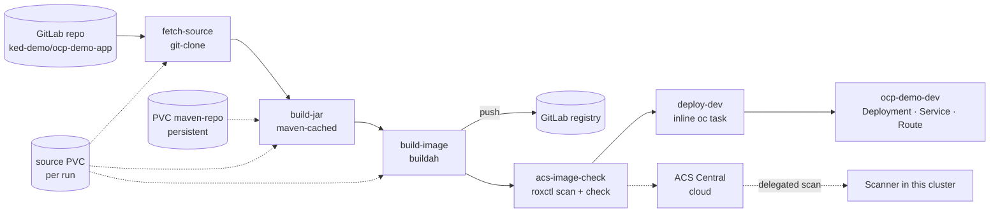

# ACT 5 — Build & Deploy Pipeline (Tekton + ACS)

> **Script:** `scripts/32-pipeline-build-deploy.sh` (live, ~15 min incl. the first build)
> **Manifests:** `cicd/tekton/build/task-maven-cached.yaml` · `cicd/tekton/build/task-acs-image-check.yaml` · `cicd/tekton/build/pipeline-build-deploy.yaml`
> **App:** `app/ocp-demo-app/src/main/docker/Dockerfile` (Quarkus fast-jar on `ubi9/openjdk-17-runtime`)
> **Prerequisites:** `scripts/30-gitlab-setup.sh` · ACS Central URL and API token in `keys.txt` as `acs_url:https://<central>` and `acs:<token>` (git-ignored)
> **Overview:** A real CI pipeline: source from GitLab → Maven (with a persistent cache) → container image pushed to the GitLab registry → **Red Hat ACS** vulnerability scan and policy gate → deployment to the dev project, by image digest.

---

## The Pipeline



| Task | Source | What it does |
|---|---|---|
| `fetch-source` | `git-clone` (cluster resolver) | Clones the GitLab repo; result `COMMIT` |
| `build-jar` | **`maven-cached`** (ours) | `mvn package -DskipTests` with `-Dmaven.repo.local` on the `maven-repo` PVC |
| `build-image` | `buildah` (cluster resolver) | Builds `src/main/docker/Dockerfile`, pushes `<registry>/ked-demo/ocp-demo-app:<commit>`; result `IMAGE_DIGEST` |
| `acs-image-check` | **`acs-image-check`** (ours) | `roxctl image scan` (report, Critical/Important) + `roxctl image check` (**fails** on enforced build policies) |
| `deploy-dev` | inline `taskSpec` (`ose-cli-rhel9`) | Deployment/Service/Route in `ocp-demo-dev`, image **by digest**, annotated with the Git commit, env `APP_COLOUR=blue` (same as the gitops base in step 36). Runs only when param `deploy-mode` = `oc` (default). `none` = merge-request runs (step 35); `gitops` = task `deploy-gitops` instead (step 37) |

> **Key point:** The image is referenced by **digest** from the build onwards — what ACS scanned is exactly what runs. A tag could be moved; a digest cannot.

---

## What the Script Does

| Part | Action | Idempotency |
|---|---|---|
| 1 | Pipeline overview | — |
| 2 | Projects `ocp-demo-cicd` / `ocp-demo-dev`; SA `pipeline` gets `edit` in dev only | create-or-reuse, `oc policy` |
| 2 | Secret `gitlab-registry` (GitLab CI token): push from cicd, pull in dev (linked to SA `default`) | `--dry-run \| oc apply` |
| 2 | Secret `rox-auth` (`endpoint`, `token`, `cluster`) from `keys.txt` | `--dry-run \| oc apply` |
| 2 | ACS API: image integration **`ked-demo-gitlab`** (registry credentials, `insecure`) + **delegated scanning** for the registry → this cluster | upsert / only if missing |
| 2 | **Scanner V4 pre-flight:** restarts `scanner-v4-indexer` if the DB Pod is younger (lost schema after a reboot) | no-op when healthy |
| 2 | PVC `maven-repo` (2Gi, RWO) — the Maven cache | `oc apply` |
| 3 | Applies the 2 Tasks and the Pipeline (shown in full) | `oc apply` |
| 4 | `tkn pipeline start … --showlog` | new run each time |
| 5 | Pipeline results, image digest + Git commit on the Deployment, `curl /api/info`, links (GitLab registry, ACS) | — |
| 6 | Optional second run → `build-jar` duration with a warm cache | prompt `y/N` |

Secrets are never printed: `show_cmd` displays `<ci-token>` / `<acs-api-token>` placeholders.

---

## Why Each Piece

### Task order: implicit vs explicit

The order of the tasks is not the order they appear in the YAML — Tekton builds a **DAG**:

- **Implicit:** a task that consumes `$(tasks.<other>.results.<X>)` automatically runs after `<other>`. `acs-image-check` has **no `runAfter`**: it uses `$(tasks.build-image.results.IMAGE_DIGEST)`, and the digest cannot exist before the build, so the dependency is already there.
- **Explicit:** `runAfter` is needed only when nothing is consumed. `build-jar` shares just the workspace with `fetch-source`, and `deploy-dev` / `deploy-gitops` use the digest from `build-image` — without `runAfter: [acs-image-check]` they would start **in parallel with the scan** and the gate would be worthless.

> **Key point:** Data flow defines the order for free; `runAfter` is for ordering that carries no data — exactly the case of a security gate.

### Maven cache without RWX

The shipped `maven` Task keeps `~/.m2` in an `emptyDir`, so every run downloads all dependencies. `maven-cached` mounts a second workspace (`maven-repo`, a **persistent** PVC) as the local repository.
Binding two PVCs to one TaskRun needs the affinity-assistant mode **`coschedule: pipelineruns`** (set in step 30). All PVCs of a run land on the same node, so **ReadWriteOnce** storage is enough.

| | First run (empty cache) | Next runs |
|---|---|---|
| `build-jar` | ~60 s Maven (downloads ~215 MB of dependencies) | ~17 s Maven (~25 s task incl. Pod start) |

> **Tip:** The PART 6 comparison is most visible on a fresh cluster (or after `oc delete pvc maven-repo -n ocp-demo-cicd` before the session's first run).

> **Note:** GitLab CE has no Maven proxy (the virtual registry is Premium/Ultimate). In production a Nexus/Artifactory mirror (`MAVEN_MIRROR_URL`) or OCI-based caches (`cache-fetch`/`cache-upload` StepActions) are alternatives.

### ACS: delegated scanning

ACS Central runs as a **cloud service**; it cannot reach `registry.apps.<cluster>` on the private network. The cluster is an ACS **SecuredCluster** with a local scanner, so the scan is **delegated**:

1. `roxctl` (in the pipeline) asks Central to scan the image, with `--cluster <name>`.
2. Central forwards the request to Sensor in this cluster.
3. The local Scanner V4 indexer pulls the image (with the credentials of the `ked-demo-gitlab` integration) and indexes it; Central matches vulnerabilities and evaluates policies.

`roxctl image check` fails the task when a policy with **build-time enforcement** is violated. On this Central the default policy **"Fixable Severity at least Important"** is enforced at build time — any fixable Critical/Important CVE stops the pipeline before deployment.

> **Note:** Two fixes were needed before this gate passed — a realistic DevSecOps moment:
> - **App dependencies:** Quarkus 3.8.6 → **3.40.1 (LTS)**. The old version shipped fixable Critical/Important CVEs (netty, jackson, vertx-http).
> - **Base image:** even the latest `ubi9/openjdk-17-runtime:1.24` can lag behind RHEL errata (e.g. `pcre2`). The Dockerfile runs `microdnf -y update` so fixed RPMs are always applied at build time. CVEs **without** a fix (`FIXED VERSION -`) still show in the report but do not violate the "Fixable" policy.
>
> Step 34 reproduces the failure on purpose.

### Registry trust and credentials

- **Push** (buildah): `gitlab-registry` Secret as the `dockerconfig` workspace, `TLS_VERIFY=false` (self-signed Router certificate).
- **Pull** (kubelet in `ocp-demo-dev`): the same Secret linked to SA `default`; the nodes trust the Router CA through `image.config` `additionalTrustedCA` (step 30).
- **Deploy**: SA `ocp-demo-cicd/pipeline` has `edit` in `ocp-demo-dev` only — the pipeline cannot touch anything else.

---

## Run It

```bash
./scripts/32-pipeline-build-deploy.sh
```

The script explains the two kinds of input before starting the run:

| Flag | What it passes | In this pipeline |
|---|---|---|
| `-p` | **Params** — strings, "what to do". `$(params.x)` in the YAML; `--use-param-defaults` fills in the ones you omit | `git-url`, `image-repo`, `deploy-mode`, … |
| `-w` | **Workspaces** — volumes, "where to do it". Each task is its own Pod, so files travel over a shared volume; the Pipeline names it, the run decides what is behind it | `source` (`volumeClaimTemplateFile` → fresh PVC per run) · `maven-repo` (`claimName` → the persistent cache) · `registry-auth` (`secret` → push credentials as a file) |

> **Key point:** Anything large or sensitive goes to a workspace, not a param — params are stored in plain text in the PipelineRun object, a Secret stays a Secret.

Watch the run in the console while the logs stream in the terminal: **Pipelines → PipelineRuns → build-deploy-run-xxxxx** (graph turns green task by task).

Re-run the pipeline by hand (same parameters):

```bash
tkn pipeline start build-deploy -n ocp-demo-cicd --last --showlog
```

---

## What to Show

1. **Console → PipelineRun graph**: the five tasks; click `acs-image-check` → logs with the vulnerability table and the policy check.
2. **GitLab → ked-demo/ocp-demo-app → Deploy → Container Registry**: tag = Git commit SHA.
3. **ACS → Vulnerability Management → Images**: the scanned image and its components.
4. **Project `ocp-demo-dev` → Topology**: the app; Deployment annotations `ked-demo/git-commit`, `ked-demo/pipeline-run`.
5. **Second run**: `build-jar` Maven time drops from ~60 s (cold) to ~17 s (warm cache).

---

## Verify

```bash
tkn pipelinerun list -n ocp-demo-cicd
oc get deployment ocp-demo-app -n ocp-demo-dev -o jsonpath='{.spec.template.spec.containers[0].image}{"\n"}'   # ...@sha256:...
curl -sk https://$(oc get route ocp-demo-app -n ocp-demo-dev -o jsonpath='{.spec.host}')/api/info
oc get pvc maven-repo -n ocp-demo-cicd
```

---

## Troubleshooting

| Symptom | Cause / Fix |
|---|---|
| `ACS Central URL not found` | Add `acs_url:https://<central>` to `keys.txt` in the repo root (git-ignored), or export `ACS_CENTRAL_URL` before running the script. |
| `ACS API token not found` | Add `acs:<token>` to `keys.txt` in the repo root (git-ignored). Token role: Admin or a role allowed to manage integrations and scan images. |
| `image-scan`: `could not scan image … 401` | ACS integration credentials missing/outdated — re-run the script (integration is upserted with the current CI token). |
| `image-scan`: `create index … Database operation failed` / `relation "manifest_metadata" does not exist` | The Scanner V4 indexer builds its schema only at startup, so a DB Pod that starts **after** the indexer (e.g. its PVC re-provisioned after a node reboot) leaves it talking to an empty database. The script pre-flights this and self-heals; to fix by hand: `oc rollout restart deploy/scanner-v4-indexer -n rhacs-operator`. |
| `image-check`: `failed policies found … Fixable Severity at least Important` | The image has fixable Critical/Important CVEs and the policy is enforced at build — upgrade the dependency, rebuild (the Dockerfile's `microdnf update` picks up new RPM errata). This is the gate working (step 34). |
| `deploy-dev`: `TaskRunImagePullFailed … image-registry.openshift-image-registry.svc:5000/openshift/cli` | The shipped `openshift-client` Task needs the internal registry (`Removed` on this cluster) — that is why `deploy-dev` is an inline task with `registry.redhat.io/openshift4/ose-cli-rhel9`. |
| `TaskRunValidationFailed: more than one PersistentVolumeClaim is bound` | TektonConfig coschedule is `workspaces` — re-run `scripts/30-gitlab-setup.sh`. |
| App pod `ImagePullBackOff … x509: certificate signed by unknown authority` | Router CA not in `image.config` `additionalTrustedCA` — re-run `scripts/30-gitlab-setup.sh`. |
| App pod `ImagePullBackOff … unauthorized` | `gitlab-registry` Secret not linked for pulls: `oc secrets link default gitlab-registry --for=pull -n ocp-demo-dev`. |

---

## Cleanup

```bash
./scripts/39-teardown.sh
```

Deletes `ocp-demo-cicd` (pipelines, runs, Maven cache) and `ocp-demo-dev` (app), plus everything from step 30. The ACS image integration `ked-demo-gitlab` is removed as well; the delegated-scanning registry entry is kept (shared with other labs on the same Central).

---

## ⬅️ Previous: [OpenShift Pipelines Introduction](31-pipelines-intro.md) | ➡️ Next: [DevSecOps: ACS Gate](34-acs-image-check.md)
