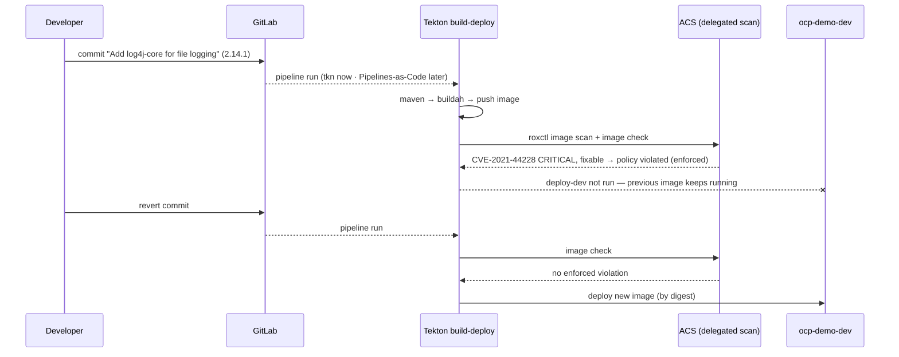

# ACT 5 — DevSecOps: ACS Gate in the Pipeline

> **Script:** `scripts/34-acs-image-check.sh` (live, ~10 min — two pipeline runs)
> **Prerequisite:** `scripts/32-pipeline-build-deploy.sh` (pipeline, secrets, app deployed in `ocp-demo-dev`)
> **Overview:** A developer adds a dependency with a known critical vulnerability (**Log4Shell**). The image builds and is pushed, but **Red Hat ACS** stops the pipeline before deployment. Reverting the commit opens the gate again.

---

## The Gate

ACS evaluates policies at three lifecycle stages:

| Stage | Where | Enforcement |
|---|---|---|
| **Build** | `roxctl image check` in the pipeline | non-zero exit → the Tekton task fails |
| Deploy | Admission controller in the secured cluster | object creation/update rejected |
| Runtime | Collector (process/network activity) | pod killed / scaled to zero |

The pipeline's `acs-image-check` task (step 32) runs `roxctl image check`. The policy that closes the gate lives on ACS Central, not in the pipeline YAML:

| Policy | Criteria | Lifecycle | Enforcement |
|---|---|---|---|
| **Fixable Severity at least Important** (`ACS_GATE_POLICY`) | `Fixed By: .*` and `Severity >= IMPORTANT` | Build, Deploy | `FAIL_BUILD_ENFORCEMENT` |
| Log4Shell: log4j Remote Code Execution vulnerability (default) | CVE-2021-44228 / CVE-2021-45046 | Build, Deploy | none — reported as a warning |

> **Key point:** Security owns the rule in ACS; every pipeline that calls `roxctl image check` obeys it. Changing the policy changes the gate for all teams without touching any pipeline.

> **Note:** This Central is shared — the demo reuses the existing build-enforced default policy. If it is not enforced, PART 1 of the script warns and the pipeline only reports.

---

## Flow



---

## What the Script Does

| Part | Action | Idempotency |
|---|---|---|
| 1 | Reads the gate policy from the Central API (criteria, lifecycle, enforcement); shows the image currently deployed in dev | — |
| 2 | Commits `log4j-core 2.14.1` to `pom.xml` on `main` via the GitLab API (author "Dev Eloper") | only if not already present |
| 3 | Runs `build-deploy` → fails at `acs-image-check`; shows the findings and that dev still runs the previous image | new run |
| 4 | Reverts the commit via the GitLab API, runs the pipeline again → succeeds and deploys | revert only if present |
| 5 | Last runs, deployed image + commit, `/api/info` | — |

> **Note:** Once Pipelines-as-Code is connected (step 35), the script does not start runs with `tkn`: the commit and the revert are pushes to `main`, so it waits for the PipelineRuns created by the webhook.

The commit added to `pom.xml`:

```xml
<!-- File logging -->
<dependency>
  <groupId>org.apache.logging.log4j</groupId>
  <artifactId>log4j-core</artifactId>
  <version>2.14.1</version>
</dependency>
```

---

## What to Show

1. **ACS → Platform Configuration → Policy Management** → *Fixable Severity at least Important*: criteria, lifecycle, **enforcement** on Build.
2. **GitLab → commit** "Add log4j-core for file logging": an innocent-looking one-line change.
3. **Console → PipelineRun graph**: green up to `build-image`, red `acs-image-check`, `deploy-dev` never started.
4. **`acs-image-check` logs**: `log4j-core 2.14.1 … CVE-2021-44228 … CRITICAL … fixed 2.15.0`, `Policy "Fixable Severity at least Important"`, `failed policies found`.
5. **GitLab → Container Registry**: the vulnerable image *was* pushed — it is just never deployed. (Deploy-time enforcement of the same policy would also stop a manual `oc set image`.)
6. **Topology `ocp-demo-dev`**: still the previous image; after the revert, a new rollout with the revert commit in the `ked-demo/git-commit` annotation.

---

## Verify

```bash
tkn pipelinerun list -n ocp-demo-cicd --limit 3            # Succeeded, Failed, ...
tkn pipelinerun logs <failed-run> -n ocp-demo-cicd -t acs-image-check | grep -i log4j
oc get deployment ocp-demo-app -n ocp-demo-dev -o jsonpath='{.metadata.annotations.ked-demo/git-commit}{"\n"}'
```

---

## Troubleshooting

| Symptom | Cause / Fix |
|---|---|
| Pipeline with log4j **succeeds** | Policy not enforced at build time on Central (PART 1 warns). Enable *Fixable Severity at least Important* → enforcement on Build, or point `ACS_GATE_POLICY` to another enforced policy. |
| Pipeline after the revert still fails | Another fixable Important+ CVE appeared since step 32 (new errata/advisory). Check the scan table; rebuild (`microdnf update` picks up RPM fixes) or upgrade the dependency. |
| `Commit failed` / `Revert failed` | GitLab root token invalid — re-run `scripts/30-gitlab-setup.sh`. A revert conflict means `pom.xml` changed after the commit — fix by hand in GitLab. |
| `could not scan image … Database operation failed` | See step 32 troubleshooting (Scanner V4 indexer restart). |

---

## Cleanup

Nothing to clean up: the script leaves `main` reverted and the good image deployed. To re-run it, simply start it again (a new vulnerable commit is made and reverted).
`scripts/39-teardown.sh` removes all ACT 5 projects and settings.

---

## ⬅️ Previous: [Build & Deploy Pipeline](32-pipeline-build-deploy.md) | ➡️ Next: [Pipelines-as-Code](35-pipelines-as-code.md)
