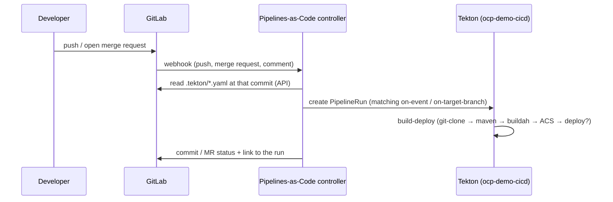

# ACT 5 — Pipelines-as-Code (GitLab)

> **Script:** `scripts/35-pipelines-as-code.sh` (live, ~10 min — two automatic runs)
> **Manifests:** `cicd/tekton/pac/repository.yaml` · `cicd/tekton/pac/push.yaml` · `cicd/tekton/pac/pull-request.yaml` (envsubst templates)
> **Prerequisites:** steps 30, 32 (pipeline `build-deploy`, secrets, Maven cache); step 34 for the story
> **Overview:** No more `tkn pipeline start`. Git events drive the pipeline: a **push to main** builds, scans and deploys; a **merge request** builds and scans, and GitLab shows the verdict on the MR **before** anyone merges.

---

## How It Works



| Piece | Where | Owner |
|---|---|---|
| `Repository` CR `ocp-demo-app` | `ocp-demo-cicd` | platform — links the GitLab project to the CI namespace |
| Secret `gitlab-pac` | `ocp-demo-cicd` | platform — GitLab API token (`tekton-ci` project token) + webhook secret |
| Project webhook | GitLab → *Settings → Webhooks* | platform — push, merge request, comment events; created via the API (same as *Settings → Webhooks → Add new webhook*) |
| `.tekton/push.yaml`, `.tekton/pull-request.yaml` | **app repo** | app team — *when* to run and *with which parameters* |
| Pipeline `build-deploy` | `ocp-demo-cicd` (cluster resolver) | platform — *how* to build, scan, deploy |

> **Key point:** The app team controls triggers in its own repo; the platform team keeps the pipeline (and the ACS gate) under its control. A developer cannot remove the security step by editing `.tekton/`.

### In-cluster connectivity

| Direction | URL | Why |
|---|---|---|
| GitLab → PAC (webhook) | `http://pipelines-as-code-controller.openshift-pipelines.svc.cluster.local:8080` | No public endpoint needed; GitLab allows local webhooks (step 30) |
| PAC → GitLab (API, status) | `http://gitlab.gitlab.svc.cluster.local` (`Repository.spec.git_provider.url`) | The Route certificate is self-signed and not trusted by the PAC controller |

`Repository.spec.url` is still the public project URL — it must match the URL in the webhook payload.

---

## The `.tekton/` PipelineRuns

```yaml
metadata:
  generateName: ocp-demo-app-push-
  annotations:
    pipelinesascode.tekton.dev/on-event: "[push]"            # pull-request.yaml: "[pull_request]"
    pipelinesascode.tekton.dev/on-target-branch: "[main]"
    pipelinesascode.tekton.dev/max-keep-runs: "10"
spec:
  pipelineRef:
    resolver: cluster          # PAC only inlines Pipelines that are inside .tekton/
    params:
      - { name: kind, value: pipeline }
      - { name: name, value: build-deploy }
      - { name: namespace, value: ocp-demo-cicd }
  params:
    - { name: git-url, value: "{{ repo_url }}" }        # PAC dynamic variables
    - { name: git-revision, value: "{{ revision }}" }
    - { name: deploy-mode, value: oc }                   # pull-request.yaml: none · step 37: gitops
  workspaces: ...                                         # same as step 32
```

The pipeline got a `deploy-mode` parameter (`when` expressions): `oc` deploys directly, `none` (merge requests) only builds and scans, `gitops` (step 37) hands delivery to Argo CD.

### `.tekton/` and branches — two separate questions

There is no "central" `.tekton/` directory. It is just files in the repo, so **every branch carries its own copy**. PAC answers two independent questions per event:

| Step | What PAC does | Which branch |
|---|---|---|
| 1. **Read** | Fetches `.tekton/*.yaml` from the commit that triggered the event | the commit's branch (**source**) |
| 2. **Match** | Evaluates `on-event` + `on-target-branch` | the event's **target** branch |

| Event | Read from | Matched against |
|---|---|---|
| `push` to `main` | `main` | `main` — *source and target are the same branch* |
| MR `feature/x → main` | `feature/x` | `main` |

> **Key point:** on a push the two are identical, so matching is **self-referential** — a `push.yaml` living in branch `UAT` must itself say `on-target-branch: "[UAT]"` to run.

This is why a push to a branch created from `main` runs nothing: it inherits a `.tekton/` that still says `[main]`, while the event's branch is `UAT`. No match, no run, no error.

#### Option A — one file, several branches (recommended)

List every branch in the annotation and keep **the same file on all of them**, so merges stay conflict-free:

```yaml
metadata:
  generateName: ocp-demo-app-push-
  annotations:
    pipelinesascode.tekton.dev/on-event: "[push]"
    pipelinesascode.tekton.dev/on-target-branch: "[main, UAT, release-*]"
spec:
  params:
    - { name: git-revision, value: "{{ revision }}" }
    - { name: dev-namespace, value: "ocp-demo-{{ target_branch }}" }   # main→ocp-demo-main, UAT→ocp-demo-UAT
```

| Push to | Reads `.tekton/` from | Matches `[main, UAT, release-*]`? |
|---|---|---|
| `main` | `main` | ✅ `main` |
| `UAT` | `UAT` | ✅ `UAT` |
| `release-2.1` | `release-2.1` | ✅ glob `release-*` |
| `feature/x` | `feature/x` | ❌ no match — nothing runs |

Globs and full refs both work: `refs/heads/*` matches any branch, `refs/tags/1.*` all tags starting with `1.`. The `{{ target_branch }}` variable lets one file serve every environment instead of duplicating it (on push events it equals `{{ source_branch }}`).

#### Option B — a different `.tekton/` per branch

Let the files diverge (`main` → `[main]`, `UAT` → `[UAT]`) when environments need genuinely different pipelines. It works, but every `UAT → main` merge tries to carry `[UAT]` over, so it needs discipline or a `.gitattributes` merge strategy.

#### Option C — CEL, when annotations are not enough

`on-cel-expression` exposes `event`, `target_branch` and `source_branch` (on push events `source_branch` equals `target_branch`):

```yaml
pipelinesascode.tekton.dev/on-cel-expression: |
  event == "pull_request" && target_branch == "UAT" && source_branch.matches(".*feat/.*")
```

The flip side: a developer **can** change `.tekton/` on their own branch and that change takes effect on the MR run. That is exactly why the PipelineRun only points at the cluster's Pipeline (`resolver: cluster`) instead of inlining it — the trigger is theirs, the pipeline and its ACS gate are not.

---

## What the Script Does

| Part | Action | Idempotency |
|---|---|---|
| 1 | Concept | — |
| 2 | Secret `gitlab-pac`, `Repository` CR, GitLab webhook | `oc apply`, webhook upserted (by URL) |
| 3 | Commits `.tekton/` to `main` → **first automatic run** (push: build → ACS → deploy); shows the commit status in GitLab | commit only if the files differ |
| 4 | Branch `feature/file-logging` + log4j commit + **merge request** → automatic MR run → **fails at the ACS gate**; status on the MR; MR closed, branch deleted | demo MR/branch recreated each run |
| 5 | `oc get repository`, last runs | — |

After this step, `scripts/34-acs-image-check.sh` detects Pipelines-as-Code and **waits for the webhook-triggered runs** instead of starting them with `tkn`.

---

## What to Show

1. **GitLab → Settings → Webhooks**: the hook, *Recent events* → HTTP 202.
2. **GitLab → Repository → `.tekton/`**: two small YAML files in the app repo.
3. **Console → PipelineRuns**: `ocp-demo-app-push-…` appears seconds after the commit — nobody ran `tkn`.
4. **GitLab → commit**: pipeline status icon (Pipelines as Code CI) linking to the OpenShift console.
5. **GitLab → merge request "Add file logging (log4j)"**: failed pipeline status on the MR; the run's `acs-image-check` logs show Log4Shell. `main` never got the change; dev still runs the previous image.
6. **Worth pointing out:** the log4j commit was first *pushed* to `feature/file-logging` and **nothing ran** — that branch's `.tekton/push.yaml` targets `[main]`. Only opening the MR (target `main`) matched `pull-request.yaml`.
7. Mention **`/retest`** as an MR comment: re-runs the PipelineRuns for the MR.

---

## Verify

```bash
oc get repository -n ocp-demo-cicd                                   # last run status
oc get pipelinerun -n ocp-demo-cicd -l pipelinesascode.tekton.dev/event-type=push
oc logs -n openshift-pipelines deploy/pipelines-as-code-controller --since=10m | grep -i error
```

---

## Troubleshooting

| Symptom | Cause / Fix |
|---|---|
| No PipelineRun after a push; webhook *Recent events* shows an error | Webhook URL/secret wrong — re-run the script. GitLab must allow local webhooks (step 30, *Admin → Settings → Network → Outbound requests*). |
| Controller log: `cannot find referenced pipeline build-deploy` | `pipelineRef` must use the **cluster resolver** (PAC does not look up Pipelines in the namespace by name). |
| Controller log: `x509: certificate signed by unknown authority` | `Repository.spec.git_provider.url` points at the Route — use the in-cluster `http://gitlab.gitlab.svc.cluster.local`. |
| MR run not started | PAC only runs MRs from users with Developer+ access (or approved via `/ok-to-test`). |
| Push to a non-`main` branch silently runs nothing | The branch's own `.tekton/` still says `on-target-branch: "[main]"`. On push, source and target are the same branch — add the branch to the annotation **in that branch's copy** (see *`.tekton/` and branches*). |
| No status on the GitLab commit/MR | The `provider.token` needs `api` scope and at least Developer role (project token `tekton-ci` is Maintainer). |

---

## Cleanup

`scripts/39-teardown.sh` removes `ocp-demo-cicd` (Repository CR, Secret) and GitLab. Without teardown, `.tekton/` and the webhook stay in GitLab — `GITLAB_RESEED=1 ./scripts/30-gitlab-setup.sh` resets the repo (`.tekton/` removed; the webhook stays and is harmless without a Repository CR).

---

## ⬅️ Previous: [DevSecOps: ACS Gate](34-acs-image-check.md) | ➡️ Next: GitOps (step 36+)
