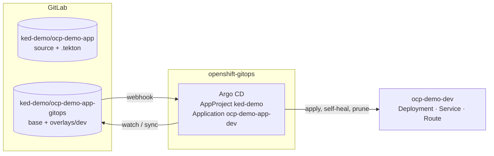

# ACT 5 — GitOps: Argo CD Takes Over the Dev Environment

> **Script:** `scripts/36-gitops-setup.sh` (live, ~8 min)
> **Manifests:** `cicd/gitops/ocp-demo-app/` (seeded into the gitops repo) · `cicd/gitops/argocd/` (AppProject + repository, Application, pipeline RBAC)
> **Prerequisites:** steps 30, 32 (app running in `ocp-demo-dev`); OpenShift GitOps operator (default instance `openshift-gitops`)
> **Overview:** The desired state of the dev environment moves into its own Git repository. **Argo CD** (OpenShift GitOps) watches it and keeps `ocp-demo-dev` in sync — it adopts the app that is already running, without redeploying it.

---

## From Push to Pull

| | Push (steps 32–35) | Pull / GitOps (from here) |
|---|---|---|
| Who changes the cluster | The pipeline (`oc apply`, `oc set image`) | **Argo CD**, running in the cluster |
| Source of truth | Whatever was applied last | **Git** (gitops repo) |
| Manual changes (`oc scale`, `oc edit`) | Stay until someone notices | Reverted automatically (self-heal) |
| Audit / rollback | Pipeline logs, re-run old pipeline | Git history, **`git revert`** |
| CI needs write access to the cluster | Yes | No — only to Git (step 37) |

> **Key point:** CI produces an artifact (image) and records *which* image an environment should run — as a commit. CD is a controller that makes the cluster match Git.

---

## Architecture



| Piece | Value | Why |
|---|---|---|
| Argo CD instance | Default `openshift-gitops` (cluster-scoped) | Installed by the operator; console integration (Environments view) |
| AppProject | `ked-demo`: only the gitops repo, only `ocp-demo-dev`, only Deployment / Service / Route, no cluster-scoped objects | Least privilege; do not use the `default` project |
| Namespace label | `argocd.argoproj.io/managed-by=openshift-gitops` on `ocp-demo-dev` | The operator then grants the Argo CD controller access to that namespace |
| Repository | Public GitLab project, HTTPS, `insecure: "true"` (repository Secret) | Self-signed Route certificate; no credentials needed to read |
| Webhook | GitLab gitops repo → `https://openshift-gitops-server.openshift-gitops.svc/api/webhook` | Sync seconds after a commit instead of the 3-minute poll |
| Sync policy | `automated: { prune: true, selfHeal: true }` | Git is applied automatically; removed objects are deleted; drift is reverted |

---

## The Gitops Repo

```
README.md
base/
  deployment.yaml        # image: ocp-demo-app (placeholder), probes, labels
  service.yaml
  route.yaml
  kustomization.yaml
overlays/dev/
  kustomization.yaml     # namespace + images: newName …/ocp-demo-app, digest: sha256:…
  deployment-patch.yaml  # annotations ked-demo/git-commit, ked-demo/pipeline-run
```

- **Kustomize**: environment-independent `base/`, environment-specific `overlays/dev/` (adding `overlays/prod/` later is a copy + a different namespace/image).
- The overlay is **seeded with the image currently running** in `ocp-demo-dev`, and the base matches the live objects (same selector, ports, probe) → Argo CD finds nothing to change: **adoption without restart**.
- Image by **digest**, never a floating tag.

---

## What the Script Does

| Part | Action | Idempotency |
|---|---|---|
| 1 | Push vs pull | — |
| 2 | GitLab project `ked-demo/ocp-demo-app-gitops` (public); seeds `cicd/gitops/ocp-demo-app/` with the running image | seeded only while empty (`GITOPS_RESEED=1` overwrites) |
| 2 | Project token `tekton-gitops` (repository read/write) → Secret `gitops-repo-auth` in `ocp-demo-cicd` (used by the pipeline in step 37) | reused while valid |
| 2 | Webhook gitops repo → Argo CD | upserted |
| 3 | `managed-by` label; AppProject + repository; Role for the pipeline (read Applications) | `oc apply` |
| 3 | Application `ocp-demo-app-dev`; waits for Synced / Healthy | `oc apply` |
| 4 | Resource tree, pods unchanged, links (Argo CD UI, console Environments, repo) | — |

---

## What to Show

1. **GitLab → ked-demo/ocp-demo-app-gitops**: `base/` and `overlays/dev/kustomization.yaml` with the image digest.
2. **Argo CD UI** (`openshift-gitops-server` Route) → Application `ocp-demo-app-dev`: tree Deployment → ReplicaSet → Pod, Service, Route; *Synced* / *Healthy*; *App details → Sync policy*.
   Log in with OpenShift (members of `cluster-admins` are Argo CD admins) or as `admin`:
   `oc extract secret/openshift-gitops-cluster -n openshift-gitops --keys=admin.password --to=-`
3. **OpenShift console → Developer → Environments**: the application and its environment, synced revision.
4. **Topology `ocp-demo-dev`**: same pod as before — nothing was redeployed.

---

## Verify

```bash
oc get application ocp-demo-app-dev -n openshift-gitops            # Synced  Healthy
oc get appproject ked-demo -n openshift-gitops
oc get ns ocp-demo-dev --show-labels | grep managed-by
oc get rolebinding -n ocp-demo-dev | grep openshift-gitops
```

---

## Troubleshooting

| Symptom | Cause / Fix |
|---|---|
| Application `Unknown` / `ComparisonError … x509` | Repository Secret missing `insecure: "true"` (self-signed Route) — re-run the script. |
| `… is forbidden: User "system:serviceaccount:openshift-gitops:openshift-gitops-argocd-application-controller" cannot …` | Namespace not labelled `argocd.argoproj.io/managed-by=openshift-gitops` (or operator RoleBinding not created yet) — re-run. |
| `resource … is not permitted in project ked-demo` | Kind not in the AppProject `namespaceResourceWhitelist` — add it to `cicd/gitops/argocd/appproject.yaml`. |
| Sync only after ~3 minutes | Webhook missing/failing — GitLab → gitops repo → *Settings → Webhooks → Recent events*. |
| Pods restarted on adoption | Base manifests differ from the live Deployment template (e.g. extra env, resources) — expected when the manifests intentionally change something. |

---

## Cleanup

`scripts/39-teardown.sh` removes the Application, AppProject, repository Secret and the pipeline Role in `openshift-gitops`, then the ACT 5 projects and GitLab (with the gitops repo).

---

## ⬅️ Previous: [Pipelines-as-Code](35-pipelines-as-code.md) | ➡️ Next: [CI → GitOps](37-pipeline-gitops.md)
