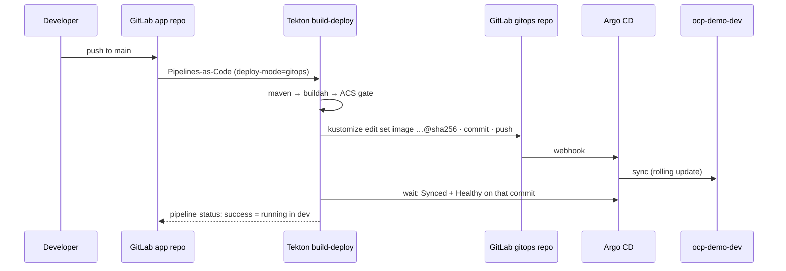

# ACT 5 — CI → GitOps: the Pipeline Delivers Through Git

> **Script:** `scripts/37-pipeline-gitops.sh` (live, ~8 min — one pipeline run)
> **Manifests:** `cicd/tekton/build/task-gitops-update-image.yaml` · `cicd/tekton/build/pipeline-build-deploy.yaml` (`deploy-mode`) · `cicd/tekton/pac/push.yaml`
> **Prerequisites:** steps 32, 35 (Pipelines-as-Code), 36 (Argo CD Application)
> **Overview:** The pipeline stops deploying. After the ACS gate it **commits the new image digest to the gitops repo** and waits until Argo CD has synced it. Switching to this mode is itself a commit in the app repo.

---

## The Flow



This is the deck's **"CI directly commits image changes"** pattern (synchronous): no gating in the lowest environment, but the pipeline result still means "deployed".

---

## Task `gitops-update-image`

| Step | Image | What it does |
|---|---|---|
| `update-manifest` | `openshift-gitops-1/argocd-rhel9:v1.22.2` (git, kustomize) | Clone the gitops repo (in-cluster `http://gitlab.gitlab.svc…`, token from Secret `gitops-repo-auth`), `kustomize edit set image ocp-demo-app=<repo>@<digest>`, update the traceability annotations, commit as *Tekton CI*, push (rebase + retry on conflicts). Result `GITOPS_COMMIT`. |
| `wait-for-argocd` | `ose-cli-rhel9` | Request a refresh, then poll the Application until `status.sync.revision == GITOPS_COMMIT`, `Synced`, `Healthy` (timeout 5 min). |

Pipeline parameter **`deploy-mode`** selects the delivery:

| `deploy-mode` | Task | Used by |
|---|---|---|
| `oc` | `deploy-dev` (oc apply/set image) | steps 32–35 |
| `gitops` | `deploy-gitops` (`gitops-update-image`) | **from this step** (`.tekton/push.yaml`) |
| `none` | — (build + scan only) | merge requests (`.tekton/pull-request.yaml`) |

`start_build_run` (used by steps 32/34) selects `gitops` automatically once the Argo CD Application exists, so re-running older steps does not fight Argo CD.

---

## What the Script Does

| Part | Action |
|---|---|
| 1 | CI writes to Git, Argo CD deploys |
| 2 | Shows and applies the Task and the pipeline's `deploy-gitops` branch |
| 3 | Commits `.tekton/push.yaml` with `deploy-mode: gitops` to the app repo → the push itself starts the pipeline (PAC) |
| 4 | Follows the image: gitops repo commit + diff (by *Tekton CI*), Application revision, image before/after, Argo CD history |
| 5 | **Least privilege**: removes the pipeline's `edit` role in `ocp-demo-dev`; `oc auth can-i` shows it can only read Applications |

If `.tekton/push.yaml` already uses `gitops`, the script starts a run with `tkn` instead (idempotent re-runs).

---

## What to Show

1. **App repo commit** "Deliver through GitOps (Argo CD)": a one-line change in `.tekton/push.yaml`.
2. **PipelineRun graph**: `deploy-dev` skipped, `deploy-gitops` runs; logs of `wait-for-argocd` counting until *Synced/Healthy*.
3. **Gitops repo → commits**: a new commit by *Tekton CI* changing only the digest and the annotations.
4. **Argo CD UI**: the sync triggered by the webhook, the rolling update, *History and rollback*.
5. **`oc auth can-i update deployments -n ocp-demo-dev --as=system:serviceaccount:ocp-demo-cicd:pipeline`** → `no`.

---

## Verify

```bash
oc get application ocp-demo-app-dev -n openshift-gitops -o jsonpath='{.status.sync.revision}{"\n"}'
oc get deployment ocp-demo-app -n ocp-demo-dev -o jsonpath='{.spec.template.spec.containers[0].image}{"\n"}'
tkn pipelinerun logs <run> -n ocp-demo-cicd -t deploy-gitops
```

---

## Troubleshooting

| Symptom | Cause / Fix |
|---|---|
| `update-manifest`: `Authentication failed` / `403` | Secret `gitops-repo-auth` missing or token expired — re-run `scripts/36-gitops-setup.sh`. |
| `wait-for-argocd`: `forbidden … applications` | Role `ked-demo-pipeline-app-reader` missing in `openshift-gitops` — re-run step 36. |
| `wait-for-argocd` times out, Application `OutOfSync` | Argo CD cannot apply (check the Application *conditions*), or the image cannot be pulled (pod events). |
| `couldn't find resource for "tekton.dev/v1, Kind=Task" … gitops-update-image` | Task not applied in `ocp-demo-cicd` — re-run step 32 or 37. |

---

## ⬅️ Previous: [GitOps Setup](36-gitops-setup.md) | ➡️ Next: [Drift & Rollback](38-gitops-drift-rollback.md)
