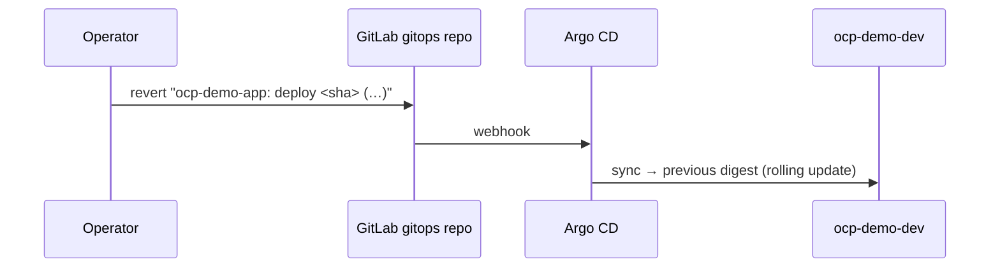

# ACT 5 — GitOps: Drift and Rollback

> **Script:** `scripts/38-gitops-drift-rollback.sh` (live, ~5 min)
> **Prerequisites:** step 36 (Argo CD Application) and step 37 (at least one image commit by the pipeline)
> **Overview:** Everyday GitOps moments. Someone changes the cluster by hand — **Argo CD puts it back**. A release turns out bad — **`git revert`** in the gitops repo rolls it back, without pipelines or `oc`. A config change (`APP_COLOUR`) — **edit a file in Git** and the app changes.

---

## 1. Drift — Self-Heal

| Manual change | What Argo CD does (`selfHeal: true`) |
|---|---|
| `oc scale deployment ocp-demo-app --replicas=3` | Detects the difference to Git (1 replica) and scales back within seconds |
| `oc delete service ocp-demo-app` | Re-creates the Service from Git |

> **Key point:** With GitOps the cluster cannot silently diverge from Git. A manual hotfix that is not committed **will be undone** — make the change in the gitops repo instead (reviewed, audited).

---

## 2. Rollback — `git revert`



- The deployment history **is** the history of `overlays/dev/kustomization.yaml`.
- The script reverts the **latest commit that changed the overlay** (normally the last image commit by *Tekton CI*). Running it again reverts the revert → roll forward.
- Argo CD's *Rollback* button is disabled while auto-sync is on — a UI rollback would be overwritten by the next sync. Git stays the source of truth.

---

## 3. Config Change — Edit Git

Not scripted — do it live in GitLab whenever it fits (before/after the script, or between its pauses).

1. Show the current value:
   ```bash
   curl -sk https://$(oc get route ocp-demo-app -n ocp-demo-dev -o jsonpath='{.spec.host}')/api/info   # "colour":"blue"
   ```
2. **GitLab → ked-demo/ocp-demo-app-gitops → `overlays/dev/env-patch.yaml` → Edit** → `value: blue` → `value: green` → *Commit to main*.
3. **Argo CD UI**: *OutOfSync* → sync (webhook, seconds) → new ReplicaSet, rolling update.
4. Same `curl` → `"colour":"green"`. Same image, new config — only Git changed.

- `APP_COLOUR` is the env form of the Quarkus property `app.colour` (default `blue` in `application.properties`).
- The change is in the **pod template** → new pods. (`deployment-patch.yaml` holds only Deployment metadata → no restart.)
- Undo = revert that commit in GitLab (*Commits → Options → Revert*). The script's rollback (Part 2) is unaffected: it only looks at commits to `overlays/dev/kustomization.yaml`.

---

## What the Script Does

| Part | Action |
|---|---|
| 1 | `oc scale --replicas=3` → watches `spec.replicas` return to 1 |
| 1 | `oc delete service` → watches it re-appear |
| 2 | Lists the overlay history in the gitops repo; reverts the latest commit via the GitLab API |
| 2 | Waits until the Application is Synced/Healthy on the revert commit; image before/after; Argo CD sync history |

---

## What to Show

1. **Argo CD UI** (keep it open): during `oc scale` the app briefly shows *OutOfSync*, then *Synced* again; the extra pods appear and disappear in the tree.
2. **Gitops repo → History** of `overlays/dev/kustomization.yaml`: image commits by *Tekton CI*, then the revert.
3. **Argo CD → History and rollback**: one entry per sync, each pointing to a Git commit.
4. **Topology `ocp-demo-dev`**: rolling update back to the previous image.

---

## Verify

```bash
oc get deployment ocp-demo-app -n ocp-demo-dev -o jsonpath='{.spec.replicas} {.spec.template.spec.containers[0].image}{"\n"}'
oc get application ocp-demo-app-dev -n openshift-gitops -o jsonpath='{.status.history}' | jq '.[-3:]'
```

---

## Troubleshooting

| Symptom | Cause / Fix |
|---|---|
| Replicas stay at 3 | `selfHeal` disabled on the Application — check `spec.syncPolicy.automated`. |
| "Only the initial commit changed the overlay" | No image commit yet — run `scripts/37-pipeline-gitops.sh` first. |
| Revert fails (conflict) | The overlay changed after that commit in a conflicting way — revert by hand in GitLab. |
| Sync after ~3 minutes only | Webhook gitops repo → Argo CD missing (step 36). |

---

## ⬅️ Previous: [CI → GitOps](37-pipeline-gitops.md) | ➡️ Next: [Teardown](../scripts/39-teardown.sh)
